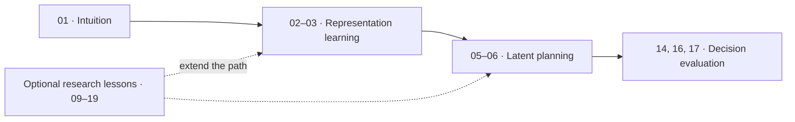

# JEPA World Models Tutorial

**From predictive representations to action selection.** This course uses runnable notebooks to teach JEPA ideas, explore recent research, and measure what a model can and cannot do.

[Start learning](CURRICULUM_GUIDE.md) · [Browse lessons](docs/CURRICULUM_COVERAGE.md) · [Explore the research roadmap](docs/ROADMAP.md) · [Read the reproduction matrix](docs/REPRODUCTION_MATRIX.md)

This repository has 19 notebooks. It separates paper-reported results from local measurements and teaching analogies. A toy result is never presented as a paper reproduction.

## Learning path

The core path moves from representation learning to planning, then asks whether those predictions help a policy choose actions.



| Step | Notebook | What you will learn |
| --- | --- | --- |
| 1 | [01 · Intuition](notebooks/01_intuition.ipynb) | See how predictive learning works and how collapse can occur. |
| 2 | [02 · LeJEPA](notebooks/02_lejepa_from_scratch.ipynb) and [03 · Rectified LpJEPA](notebooks/03_rectified_lpjepa.ipynb) | Train small models and compare representation objectives. |
| 3 | [05 · Value-guided planning](notebooks/05_value_guided_planning.ipynb) and [06 · Gradient-based planning](notebooks/06_gradient_based_planning.ipynb) | Use learned representations to plan actions in a small control task. |
| 4 | [14 · Decision usefulness](notebooks/14_decision_usefulness.ipynb), [16 · Action-conditioned planning](notebooks/16_action_conditioned_video_planning.ipynb), and [17 · Uncertainty](notebooks/17_model_uncertainty_planning.ipynb) | Measure interventions, closed-loop outcomes, and failure cases. |

The [curriculum guide](CURRICULUM_GUIDE.md) gives a teaching sequence. The [coverage map](docs/CURRICULUM_COVERAGE.md) lists every notebook, its evidence, and its limits.

## A result worth studying

In Notebook 14's MountainCar study, learned-model MPC reached the goal on 0 of 20 starts. A direct policy reached it on all 20. This is a local state-based result, not a JEPA or paper result. It shows why a good prediction score alone does not prove that a model helps with decisions. Read the [full report](docs/reproductions/decision-usefulness.md).

## Install and run

Requires Python 3.10–3.13 and [Poetry](https://python-poetry.org/docs/).

```bash
poetry install
poetry run pip install -r requirements-torch.txt
poetry run jupyter lab
```

Open `notebooks/01_intuition.ipynb` first. For a CPU-only PyTorch setup, use the alternative command in [requirements-torch.txt](requirements-torch.txt). Notebook 11 uses optional text-embedding dependencies:

```bash
poetry install --extras vljepa
```

Some optional lessons download data or model weights. Notebook 09 uses an approximately 1.66 GB checkpoint, Notebook 11 uses about 300 MB of first-run assets, and Notebook 13 uses about 800 MB of dataset files. Check the [coverage map](docs/CURRICULUM_COVERAGE.md) before starting a lesson.

## Evidence and research

Each result has an explicit status:

- **Paper-reported** — stated by a cited source.
- **Locally measured** — produced by this repository under recorded conditions.
- **Illustrative** — a teaching example, not a paper result.
- **Not run** — no local execution evidence is available.

Use the [evaluation protocol](docs/EVALUATION_PROTOCOL.md) before making a comparison. The [research roadmap](docs/ROADMAP.md) and [reproduction matrix](docs/REPRODUCTION_MATRIX.md) track current sources, planned lessons, resource needs, and open reproduction work. The full [documentation index](docs/index.md) links to reports and evidence records.

## Contribute

Contributions that improve a lesson, add a careful evaluation, or make the course easier to follow are welcome. Start with [CONTRIBUTING.md](CONTRIBUTING.md). For a new lesson or research reproduction, use the project's [Spec Kit quickstart](specs/001-project-vision/quickstart.md).
