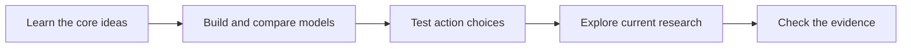

# Explore the course

*Start with a runnable lesson. Follow the evidence when you want to go deeper.*

## Choose your next step

| You want to | Start here |
| --- | --- |
| Learn the core path | [Curriculum guide](../CURRICULUM_GUIDE.md) and the [README quick start](../README.md) |
| See what each notebook proves | [Curriculum coverage](CURRICULUM_COVERAGE.md) |
| Read the research case study | [Portfolio case study](portfolio/CASE_STUDY.md) and [website manifest](portfolio/project.json) |
| Explore new research | [Research roadmap](ROADMAP.md) |
| Check or reproduce a claim | [Evaluation protocol](EVALUATION_PROTOCOL.md) and [reproduction matrix](REPRODUCTION_MATRIX.md) |
| Find a local result | [Evidence records](evidence/) and [reproduction reports](reproductions/) |
| Add a lesson | [Spec Kit quickstart](../specs/001-project-vision/quickstart.md) and [contributing guide](../CONTRIBUTING.md) |

## Read each result in context

- **Paper-reported** — the value comes from a cited paper or official source.
- **Locally measured** — this repository produced the value under recorded conditions.
- **Illustrative** — the result teaches an idea but does not test a paper claim.
- **Not run** — no local execution evidence is available.

A teaching analogy is not a paper reproduction. Each report states its task, setup, and limits.
