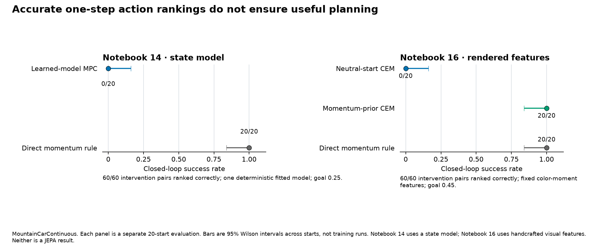
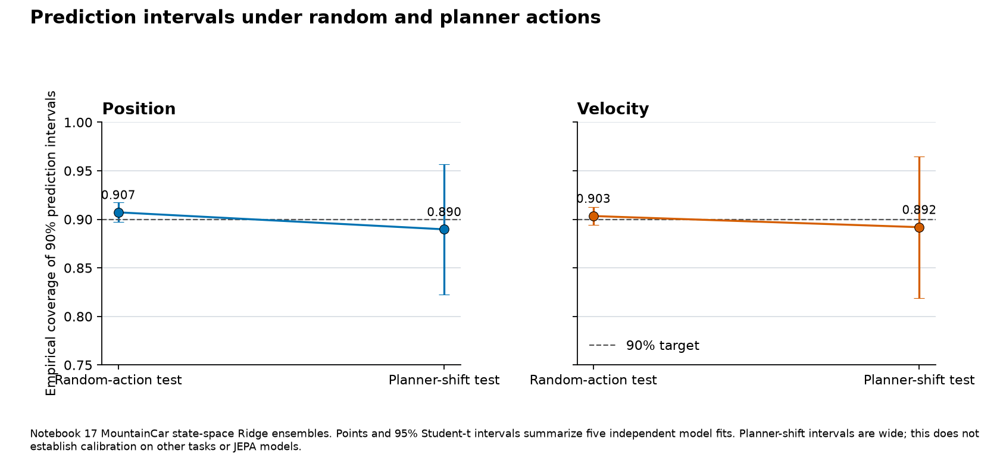
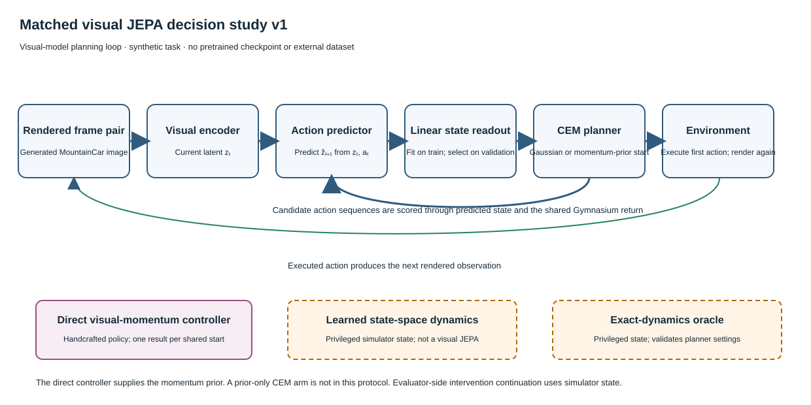

# When do predictive representations improve action selection?

This project teaches JEPA world models through runnable notebooks and local experiments. Its central question is:

> **When do predictive representations actually improve action selection, and when does accurate prediction fail to translate into effective decisions?**

The answer requires more than a low prediction error. A model must respond correctly when actions change, support a planner that finds useful actions, and improve decisions against a clear baseline at a stated compute cost.

## Research motivation

Joint-Embedding Predictive Architectures (JEPAs) predict future representations instead of reconstructing every input pixel. This can focus learning on useful structure. It does not, by itself, show that the representation supports reliable control.

Recent evaluation work calls for separate evidence about interventions, closed-loop behavior, policy ranking, optimization effects, uncertainty, and compute. A 2026 benchmark survey reports that 11 of 160 surveyed benchmarks explicitly compare a world model with a direct policy. These sources motivate the project's protocol; the local notebooks do not reproduce their results. See [Yu et al.](https://arxiv.org/abs/2606.15032) and [Jena et al.](https://arxiv.org/abs/2609.29669).

## Technical approach

The course links three stages:

1. **Learn representations.** Notebooks 02 and 03 compare LeJEPA-style SIGReg and Rectified LpJEPA-style RDMReg objectives on small CIFAR-10 subsets. Notebook 09 loads an official V-JEPA 2.1 checkpoint and inspects features from a deterministic synthetic video clip.
2. **Predict action effects.** Notebooks 14 and 17 use state-space Ridge models. Notebook 16 renders MountainCar frames, extracts fixed color-moment features, and predicts action-conditioned state changes. Notebook 22 adds learned visual predictors on a synthetic MountainCar task; it is a separate local study, not a paper reproduction.
3. **Measure decisions.** Notebooks 14, 16, and 17 compare learned or fitted predictors with direct momentum rules and planner priors. Notebooks 22 and 23 add learned visual predictors. The studies measure intervention error, task-grounded action ranking, closed-loop success, uncertainty coverage, model calls, and elapsed time.

The shared [evaluation protocol](../EVALUATION_PROTOCOL.md) keeps paper-reported, locally measured, illustrative, and not-run claims separate. The [reproduction matrix](../REPRODUCTION_MATRIX.md) records source, artifact, and compute gates for paper-level work.

## Experimental method

The local decision studies use Gymnasium's `MountainCarContinuous-v0`, but they do not all use the same task settings. Notebook 14 uses goal position 0.25 and a 300-step limit. Notebook 16 uses goal position 0.45 and a 300-step limit. Notebook 17 uses a 200-step limit. Their results are shown in separate panels and must not be pooled.

Notebook 14 uses one deterministic degree-three polynomial Ridge model trained from 6,000 simulator transitions. It tests 60 action interventions across 20 held-out states and evaluates two methods on 20 paired starts. Both methods had the same 60-second maximum elapsed-time cap. Their actual work differed: the planner used 7.68 million model transitions and 12.747 seconds; the direct momentum rule used no model transitions and 0.007 seconds.

Notebook 16 uses one fixed color-moment feature extractor and one fitted Ridge model. It checks 60 action interventions and evaluates three methods on 20 paired starts. Its momentum prior is a hand-written controller rolled forward through the model. It is not a learned policy.

Notebook 17 uses five independent state-space model fits with five bootstrap members each. It estimates 90% prediction intervals on calibration data, checks them on random-action and planner-shift data, and records 200 selected plans and 220 episode outcomes. Its intervals across model runs are 95% Student-t intervals. This is a MountainCar analogue, not a JEPA uncertainty result.

Notebook 22 uses five training-data/model seed pairs, 20 held-out intervention starts, and 20 shared closed-loop starts per learned model seed. Notebook 23 adds a separate preregistered study with a development-tuned and held-out-gated oracle planner, state, image-reconstruction, and action-conditioned latent dynamics, and two CEM initializations. Notebook 22's final models use a VISReg-style temporal-prediction adaptation, not the paper's multi-view image objective. Notebook 23 uses a LeJEPA-style SIGReg term for action-conditioned prediction. Neither notebook implements the full objective of its cited paper. Both retain separate, versioned records.

Notebook 23 uses five paired model/data seed groups. Each group supplies 4,800 training rows and 1,200 validation rows. It reserves distinct data for representation probes, action interventions, planner development, confirmation, and final starts. The exact simulator and learned state model see privileged state; the visual models receive generated frames. A train-fitted and validation-selected linear readout supports the shared task-return score. The same 20 final starts first test the exact-dynamics gate and then serve as shared comparison starts, so learned-method outcomes are conditional on that gate passing.

## Verified findings

These values are traced to the repository's notebooks, reports, and retained evidence files. “Verified” here means checked against those local records; it does not mean an independent replication or a published-paper result.

### 1. Small objective studies gave different local results

Notebook 02 trained five seeds on 640 self-supervised CIFAR-10 images with a small CNN. The mean frozen-probe difference for the paper-aligned SIGReg arm versus the teaching sketch was -0.24 percentage points, with a paired 95% interval of [-1.591, 1.111] points. The interval includes zero. SIGReg produced lower mean feature standard deviation and covariance measures in this setup.

This is a small local objective study, not the LeJEPA ImageNet-1K result. It does not show that SIGReg is generally better or worse.

Evidence: [Notebook 02](../../notebooks/02_lejepa_from_scratch.ipynb) · [run report](../reproductions/lejepa-rectified-lpjepa.md)

Notebook 03 measured a paired mean projector-probe difference of +6.94 percentage points for paper-aligned RDMReg versus the local teaching proxy. Its 95% paired interval was [2.918, 10.962] points. The encoder-probe difference was only +0.06 points, with an interval that included zero. The teaching projector was all zero for one seed and nearly zero for other seeds. This result is sensitive to a weak, degenerate proxy. It is not the paper's ImageNet-100 experiment.

Evidence: [Notebook 03](../../notebooks/03_rectified_lpjepa.ipynb) · [run report](../reproductions/lejepa-rectified-lpjepa.md)

### 2. Near-perfect one-step results did not yield successful MPC in Notebook 14

On 60 held-out action interventions, the state model's mean absolute next-position error was `2.2852e-7`, its next-velocity error was `2.7162e-7`, and it ranked all 60 non-tied action pairs correctly. Yet learned-model MPC reached the goal on 0 of 20 paired starts. The direct momentum rule reached it on 20 of 20. The planner used 7.68 million model transitions and 12.747 seconds; the direct rule used none and took 0.007 seconds.

This is strong evidence for a failure mode in these fixed MountainCar settings. It is not a JEPA result, a matched-actual-compute comparison, or evidence that direct policies always outperform learned models.

Evidence: [Notebook 14](../../notebooks/14_decision_usefulness.ipynb) · [run report](../reproductions/decision-usefulness.md)

### 3. A controller prior changed the outcome of the Notebook 16 planner

In the rendered-feature analogue, neutral-start CEM reached 0 of 20 goals. Momentum-prior CEM and the direct momentum controller each reached 20 of 20. The direct controller averaged 107.2 steps and zero model calls. Momentum-prior CEM averaged 131.2 steps and 1,286,250 model calls. Both CEM methods had the same candidate budget; the prior was hand-written.

This isolates a task-specific planner search problem: the learned local model did not make neutral action search effective, and the simple direct rule was faster than adding a planner. It does not validate learned policy-guided search such as PiJEPA.

Evidence: [Notebook 16](../../notebooks/16_action_conditioned_video_planning.ipynb) · [episode evidence](../evidence/action-video-planning-episodes.csv) · [run report](../reproductions/action-video-planning.md)

### 4. Planner-shift calibration remained uncertain across five state-model fits

Notebook 17's 90% intervals covered 90.7% of position outcomes on the random-action test, with a 95% interval of [89.7%, 91.7%] across five model fits. Under planner-shift actions, mean position coverage was 89.0%, with a wider interval of [82.2%, 95.7%]. Velocity coverage was 90.3% [89.4%, 91.2%] on random actions and 89.2% [81.9%, 96.5%] under planner shift.

The broad planner-shift intervals reflect only five independent fits. They do not establish calibration on other tasks or learned JEPA models. In the same experiment, both CEM variants reached 0 of 100 goals while a fixed direct momentum rule reached 20 of 20 starts.

Evidence: [Notebook 17](../../notebooks/17_model_uncertainty_planning.ipynb) · [calibration records](../evidence/model-uncertainty-calibration.csv) · [run report](../reproductions/model-uncertainty-planning.md)

### 5. The visual JEPA studies did not establish a decision gain

Notebook 22's five-seed study ranked 153/295 non-tied action pairs correctly (51.9%). Uniform-start JEPA CEM reached 0/100 goals; momentum-prior JEPA CEM reached 100/100, and the same hand-written direct controller reached 20/20. This showed that initialization changed outcomes, but did not isolate the JEPA model's added value.

Notebook 23 used a separate preregistered protocol. Its JEPA ranked 131/225 non-tied pairs correctly (58.2%), but its CEM reached 0/100 goals with either Gaussian or momentum-prior initialization. The direct controller reached 20/20. All five JEPA fits triggered the low-spread warning; position probes were strong (R² 0.973–0.996), while velocity probes were weak (R² −0.012–0.095). The exact oracle also reached 0/20 starts with Gaussian initialization and 20/20 with the momentum prior.

The v1 outcome remains partial and exploratory because of low spread, the missing prior-only CEM arm, paired model/data seeds, and the shared oracle gate. Notebook 22 and 23 use separate objectives and protocols. Neither is a V-JEPA 2, LeJEPA, or VISReg reproduction, and neither shows a general JEPA advantage.

Evidence: [Notebook 22](../../notebooks/22_visual_jepa_decision_usefulness.ipynb) · [Notebook 22 report](../reproductions/visual-jepa-decision-usefulness.md) · [Notebook 23](../../notebooks/23_visual_jepa_decision_study.ipynb) · [v1 report and paired analysis](../reproductions/visual-jepa-decision-study-v1.md) · [frozen protocol](../reproductions/protocols/visual-jepa-decision-study-v1.md) · [v1 evidence](../evidence/visual-jepa-decision-study-v1-analysis.json)

## Figures

**Figure 1.** Closed-loop success on separate 20-start MountainCar evaluations. Error bars are Wilson intervals over evaluation starts, not training runs. Notebook 14 uses a state-space model. Notebook 16 uses fixed color-moment features. Neither uses a learned JEPA model. Rebuild with `uv run --locked --no-sync python scripts/generate_portfolio_figures.py`.

**Figure 2.** Empirical coverage for 90% one-step prediction intervals. Points and 95% Student-t intervals summarize five independent state-space model fits. The planner-shift intervals are wide. This figure does not establish cross-task or JEPA calibration. Rebuild with the same command as Figure 1.

The original chart generator reads Notebook 14's saved episode table and the raw Notebook 16, 17, and 22 CSV records. The v1 generator reads retained episode, model, probe, and intervention records. Neither v1 figure requires model training or external downloads.

**Figure 3.** Notebook 22 and v1 results are shown separately. In v1, panel A shows 660 complete episodes and marks prior-only CEM as not run. Panel B uses 20 held-out states and three actions; ties are excluded. Panel C shows spread, probe scores, and predicted versus observed action effects. Panel D shows success against transition calls and elapsed time. The final starts also served as the oracle gate. All five JEPA fits triggered low spread; their outcomes are exploratory. The exact oracle ran on CPU and learned models ran on GPU, so compute is not matched. Rebuild with `uv run --locked --no-sync python scripts/generate_visual_jepa_decision_study_figures.py`.

**Figure 4.** The diagram describes the local synthetic study, not a published-paper implementation. The direct visual-momentum controller is handcrafted. State-space and exact-dynamics controls use privileged state. The SVG includes a title and description for assistive technology.

## Official V-JEPA checkpoint check

Notebook 09 loaded an official V-JEPA 2.1 ViT-B/384 checkpoint on CPU from a deterministic synthetic 16-frame clip. The output had shape `[1, 8, 24, 24, 768]` and finite values. Retrieval selected a patch one grid cell from the known synthetic patch; a mean-RGB baseline selected the same patch. The run confirms local checkpoint loading and feature extraction only. It does not establish general correspondence quality, planning value, or a paper benchmark result.

Evidence: [Notebook 09](../../notebooks/09_vjepa21_dense_features.ipynb) · [checkpoint and run record](../evidence/vjepa21-local-run.md)

## Reproducibility and compute

- The core environment is defined by `pyproject.toml` and `uv.lock`. Use `uv sync --locked` for the default CPU environment. Apply `requirements-torch.txt` only when a CUDA 12.8 setup is intended.
- Keep downloaded data, checkpoints, and package caches on E: or D: by setting `JEPA_ASSETS_DIR`, `UV_CACHE_DIR`, `HF_HUB_CACHE`, `HF_ASSETS_CACHE`, and `TORCH_HOME` before setup. The README gives a WSL example.
- Notebooks 14 and 16 use CPU and no external assets. Notebook 17 uses CPU and retains 60,000 calibration rows, 200 selected plans, 220 episode outcomes, and five run records.
- Notebooks 22 and 23 used CUDA on an RTX 5070. Notebook 22 retained 15 model-fit rows, 960 intervention rows, and 440 episode rows. Notebook 23 completed 15 model fits, 960 interventions, and 660 episode rows; every v1 episode passed validation, while the low-spread rule keeps JEPA outcomes exploratory. The executed notebook and runtime files stay on E:; small audit records and figures are in the repository.
- Notebook 09's checkpoint is about 1.66 GB and its license terms must be checked before redistribution. The notebook does not redistribute weights.
- The repository has a focused unit-test suite for the new portfolio evidence summaries. The evidence validator for Notebooks 20 and 21 checks record structure; it does not rerun notebooks or validate scientific claims.
- `pyproject.toml` declares MIT, but the repository has no root `LICENSE` file. Maintainers should confirm the rights holder and add the license text before describing the repository as MIT-licensed.

Notebook 22 used the RTX 5070 for its validation pilot and all 15 model fits. Notebook 23 used CUDA for five model/data seed groups across three model families and the 200 visual-model CEM episodes. The full JEPA-WAM LIBERO-Plus benchmark and the scoped 450-episode Push-T evaluation were not run. Rebuild the original figures with `uv run --locked --no-sync python scripts/generate_portfolio_figures.py`; rebuild the v1 overview and architecture with the command in Figure 3.

## Technical challenges and limits

The main challenge is a mismatch between model diagnostics and decisions. A short one-step test can hide compounding errors, poor search, a mismatched objective, or a policy that does not need a model. Model calls and wall time also vary sharply between a planner and a direct rule.

The action-ranking checks cover three candidate actions at sampled states. They do not certify every action sequence. Finite-horizon CEM can miss useful sequences because of its candidate budget, horizon, or rollout objective. The current experiments do not isolate planner optimization failure from model error.

The strongest decision findings are small simulator studies. Notebook 14 uses one state model; Notebook 16 uses one fixed-feature visual analogue; Notebook 17 uses five state-model fits but one task; Notebooks 22 and 23 use learned visual models on one synthetic task, with a hand-written controller prior. Notebook 23's five JEPA fits triggered low spread and had no successful planner episodes; these remain exploratory. None establishes a general learned-JEPA advantage. The SIGReg and RDMReg studies use small data subsets and local CNNs. The official V-JEPA run verifies inference on one synthetic clip, not downstream benefit.

## Prioritized future research

The project's next major research result should be a genuine learned-JEPA-versus-direct-policy comparison. Select one visual control task only after its data, checkpoint, license, simulator, and compute requirements are confirmed. Do not report a result from a toy analogy as that comparison.

Compare these systems on the same fixed cases:

1. **Oracle dynamics** — upper-bound planner reference with the simulator transition function.
2. **Learned state-space dynamics** — non-visual model baseline with the same collected trajectories.
3. **Learned visual latent dynamics** — visual encoder plus latent transition predictor.
4. **Action-conditioned JEPA dynamics** — the target predictive representation model, with exact paper/code revisions recorded.
5. **Direct policy** — policy trained from the same allowed data and observation stream, without planning through a learned model.
6. **Policy-guided planning** — use that direct policy to initialize or constrain search over the learned model. Keep this separate from unconstrained planning.

Before execution, preregister the task, train/validation/test split, fixed evaluation starts, seed count, stopping rules, primary outcome, and compute budget. Use shared training data and paired evaluation starts. Record one-step prediction, changed-action intervention fidelity, action-ranking agreement, closed-loop success and return, policy-ranking agreement, calibration and failures, model calls, elapsed latency, and training/evaluation compute. Report each training seed and each test case. Select sample counts from a precision target or power analysis; do not choose them after seeing results.

Make a research claim only when the exact learned models and baselines are identified, the full planned run set is retained, no evaluation data was used for tuning, results can be independently regenerated, and the conclusion is supported by decision outcomes as well as prediction metrics. If compute or source access blocks the plan, publish a preflight and mark the experiment pending.

For current candidate papers and access gates, see the [research roadmap](../ROADMAP.md), especially its entries for [PiJEPA](https://arxiv.org/abs/2603.25981), [V-JEPA Policy](https://arxiv.org/abs/2609.37250), [JEPA-WAM](https://arxiv.org/abs/2608.09381), [physical-state grounding](https://arxiv.org/abs/2608.06799), control-grounded [GA-WM](https://arxiv.org/abs/2609.03565), and [point-cloud JEPA](https://arxiv.org/abs/2608.29434). The large JEPA-WAM and 450-episode Push-T evaluations remain pending.

## Source and evidence links

- [Curriculum guide](../../CURRICULUM_GUIDE.md) · [coverage map](../CURRICULUM_COVERAGE.md)
- [Evaluation protocol](../EVALUATION_PROTOCOL.md) · [protocol audit](../evidence/evaluation-protocol-audit.md)
- [Reproduction matrix](../REPRODUCTION_MATRIX.md) · [research roadmap](../ROADMAP.md)
- [LeJEPA paper](https://arxiv.org/abs/2511.08544) · [Rectified LpJEPA paper](https://arxiv.org/abs/2602.01456)
- [V-JEPA 2 paper](https://arxiv.org/abs/2506.09985) · [official V-JEPA 2 code](https://github.com/facebookresearch/vjepa2)
- [PiJEPA paper](https://arxiv.org/abs/2603.25981) · [decision-centric evaluation paper](https://arxiv.org/abs/2606.15032) · [world-model benchmark survey](https://arxiv.org/abs/2609.29669)
