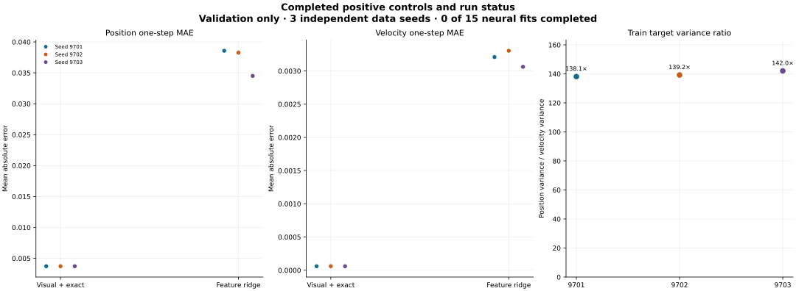

# v3 Observed Positive-Control Figures

## figure-a-observed-action-fidelity

**Caption:** Simulator, handcrafted state plus exact dynamics, and handcrafted ridge action effects. The ridge uses the same handcrafted state features but a fixed linear map.

**Sample size:** 20 shared validation action contexts for each of 3 independent data seeds

**Limitations:** No visual neural fit completed. This figure measures one-step prediction only and does not show planning performance.

## figure-b-observed-positive-controls

**Caption:** Raw validation MAE for handcrafted state plus exact dynamics and the fixed handcrafted-feature ridge model, alongside the training next-state position-to-velocity variance ratios.

**Sample size:** Full validation partition per seed for MAE; 20 training episodes per seed for target scales

**Limitations:** The ridge model is a fixed linear baseline and cannot establish what a learned visual encoder can achieve. The neural study stopped before training.
